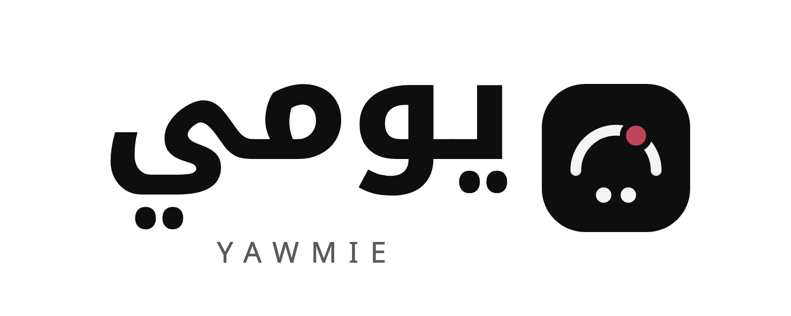
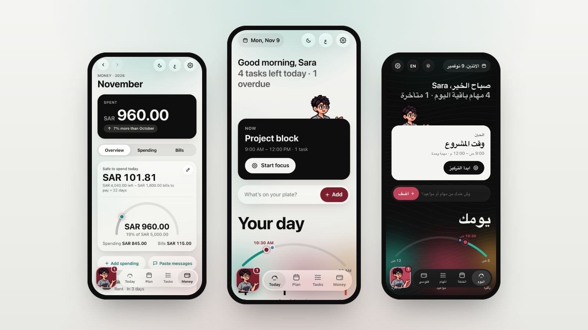
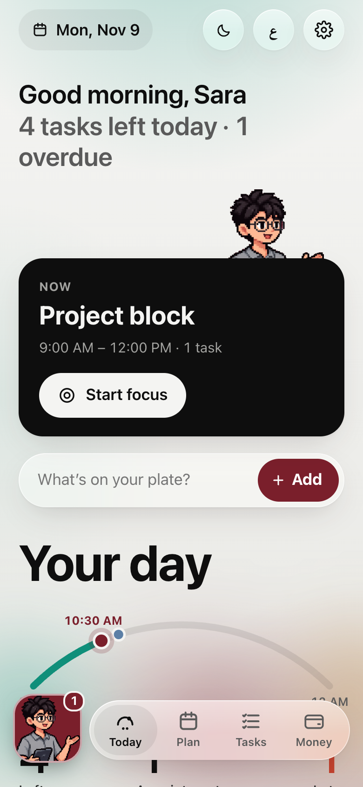
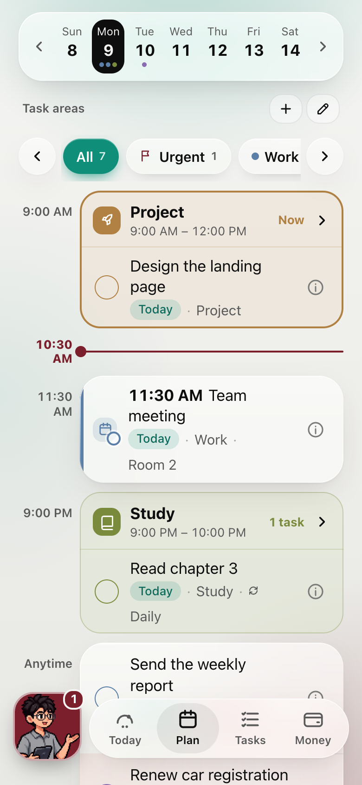
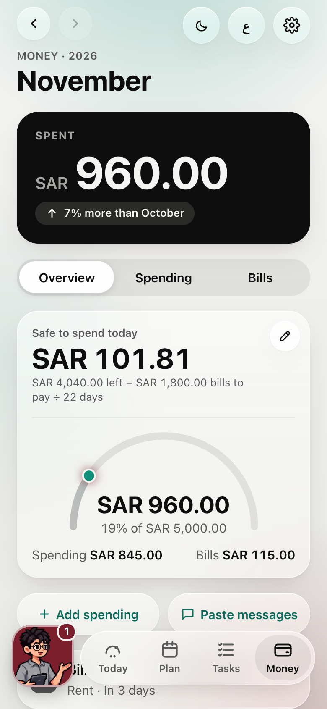
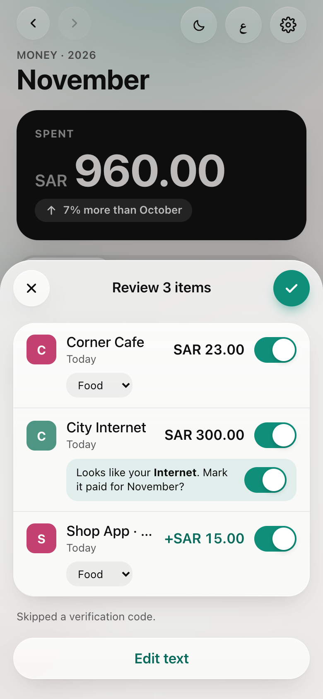
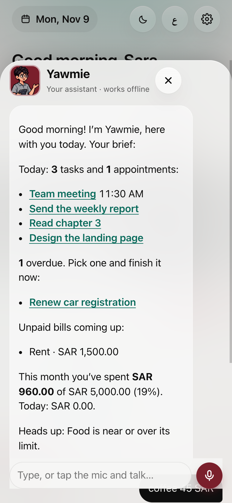
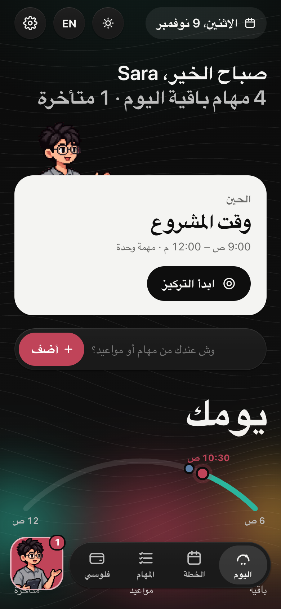

<p align="center">
  <picture>
    <source media="(prefers-color-scheme: dark)" srcset="brand/logo/yawmie-lockup-light-text.png">
    
  </picture>
</p>

<h3 align="center">Your day and your money, in one calm place.</h3>

<p align="center">Tasks, appointments, time blocks, bills, spending, and a friendly assistant, on your iPhone.<br>Arabic and English. Free, private, open source.</p>

<p align="center">
  <a href="https://yawmie.me"><b>Website</b></a> ·
  <a href="https://yawmie.me/app/"><b>Open the app</b></a> ·
  <a href="#use-it-in-claude-as-an-artifact"><b>Use it in Claude</b></a> ·
  <a href="#two-ways-to-use-it"><b>Get started</b></a> ·
  <a href="CONTRIBUTING.md"><b>Contribute</b></a>
</p>

<p align="center"><b>English</b> · <a href="README.ar.md">العربية</a></p>

<p align="center">
  
  
  
  
  
</p>

<p align="center"></p>

> **Status:** in development. Not ready to use yet.

## What you can do

<table>
<tr>
<td align="center" width="33%" valign="top"><br><b>Today at a glance</b><br><sub>Next up, quick add, and your day as one arc</sub></td>
<td align="center" width="33%" valign="top"><br><b>Plan with time blocks</b><br><sub>Repeating blocks for work, study and more, with Focus</sub></td>
<td align="center" width="33%" valign="top"><br><b>Safe to spend</b><br><sub>Budgets, bills and how much you can spend today</sub></td>
</tr>
<tr>
<td align="center" width="33%" valign="top"><br><b>Paste bank messages</b><br><sub>Read on your phone, reviewed, matched to your bills</sub></td>
<td align="center" width="33%" valign="top"><br><b>Talk to Yawmie</b><br><sub>A daily brief, and add things from one sentence</sub></td>
<td align="center" width="33%" valign="top"><br><b>Arabic and English</b><br><sub>Right-to-left, light and dark, digits 0–9</sub></td>
</tr>
</table>

- **Nothing is saved without your OK**: every item is confirmed first.
- **Reminders** through Apple Reminders, with the "Yawmie Reminder" shortcut.
- **Backups** are one file you keep; Yawmie reminds you once a month.

## Two ways to use it

| | Website app | Claude artifact |
|---|---|---|
| How | Open **yawmie.me/app** in Safari → Share → Add to Home Screen | Once, from a computer: Claude desktop app → Code, paste one message (below) |
| Your data lives | Only on your phone | In your own Claude account, private to you |
| Works offline | Yes | No |
| Voice and reminders | Yes | No (Claude blocks them) |

Everyone starts with an empty app. There's no account, no server and no tracking.

## Use it in Claude (as an artifact)

The Claude version is a **Claude artifact**: a small, private app page inside your own Claude account. Your data saves there automatically, and you open it from the Claude app on any device, phone included.

Each person makes their own copy, so it saves in their own account. Set it up **once, from a computer**:

1. Open the **Claude desktop app** and choose **Code**.
2. Paste this message:

   > Publish Yawmie for me from github.com/ferashayf/Yawmie (latest release, yawmie-artifact.html) as an artifact with saving (db, user, downloads) turned on.

3. Claude publishes your own private copy. Open it in Claude from any device.

A normal Claude chat can't do step 3: the app file is too big for Claude to write out in a chat reply.

## Privacy

- No backend, no accounts, no analytics, no third-party calls.
- Website app: your data never leaves your phone. Back it up with Export (one file).
- Bank messages you paste are read on the phone; card numbers and message text are never stored.

## For developers

How it's built: [ARCHITECTURE.md](ARCHITECTURE.md). What it does: [PRD.md](PRD.md). How to help: [CONTRIBUTING.md](CONTRIBUTING.md).

Run locally (Node 24):

```bash
npm install
npm run dev              # website app at http://localhost:5173
npm test                 # all tests
npm run build            # website app → dist/
npm run build:artifact   # Claude artifact → dist-artifact/index.html
```

## License

Code: [MIT](LICENSE). The name Yawmie / يومي, the character, the logo, the icon and all artwork, screenshots included, are **all rights reserved**: see [TRADEMARKS.md](TRADEMARKS.md). Forks use their own name and art. Third-party files in `site/vendor/` (GSAP) keep their own license, noted at the top of each file.
