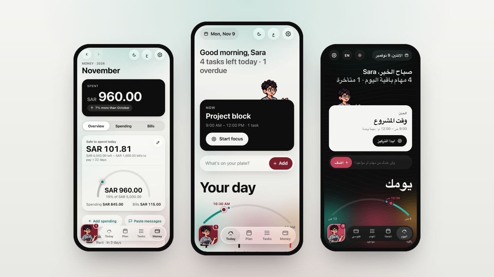
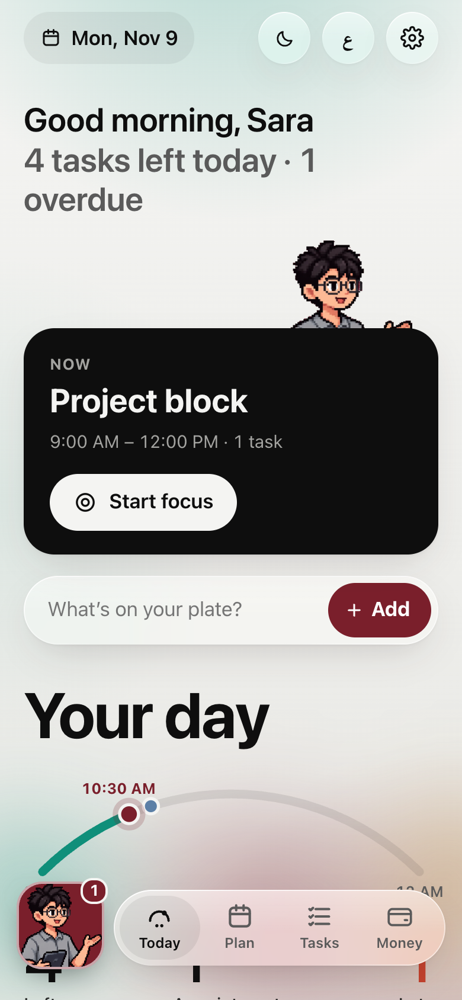
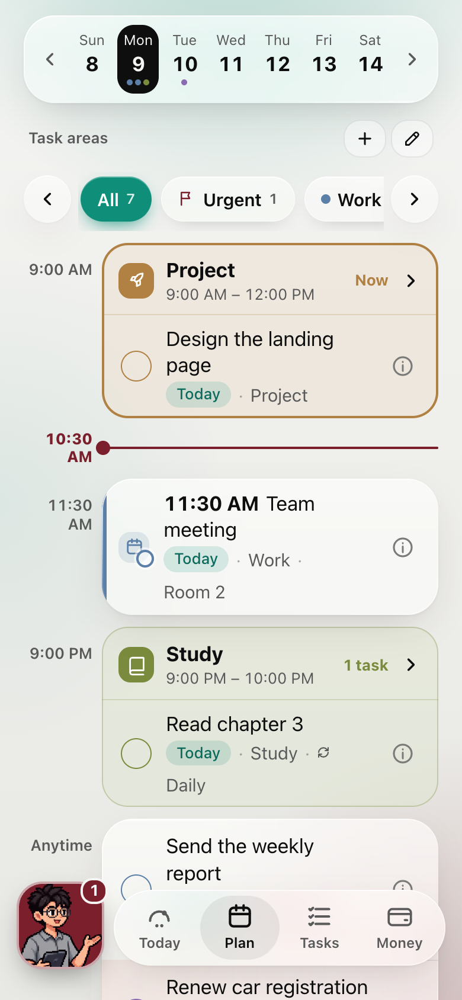
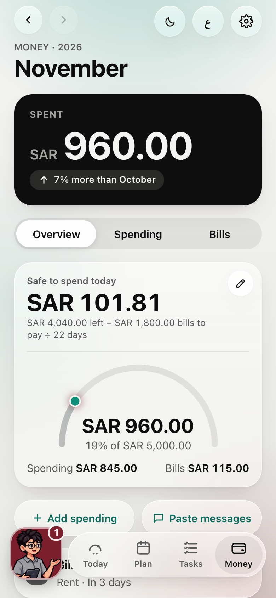
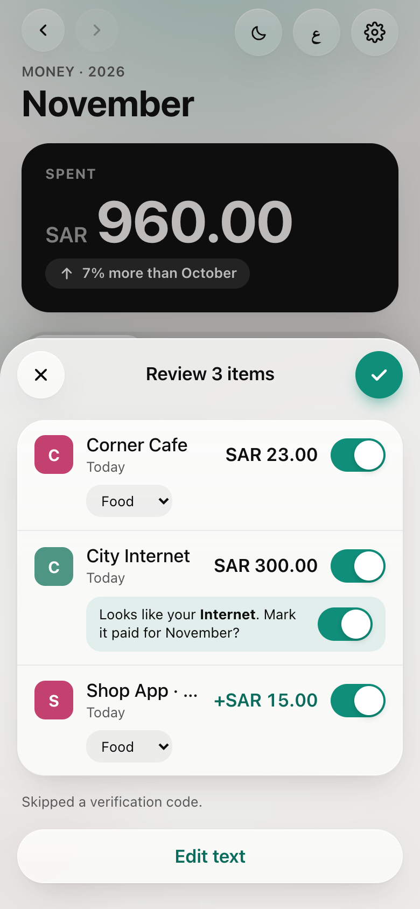
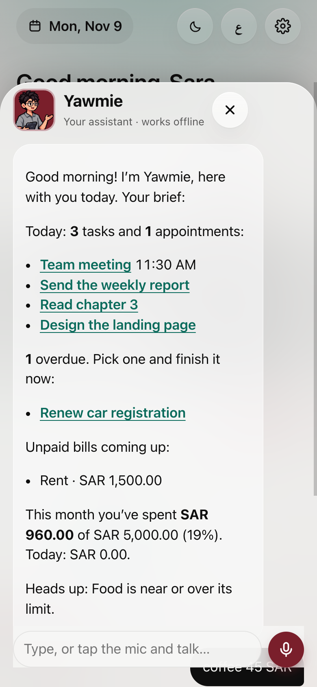
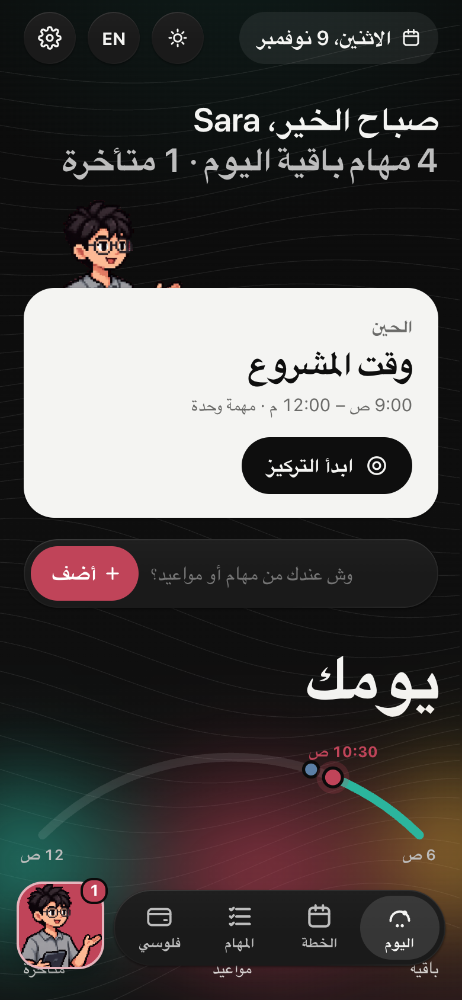

<h1 align="center">يومي · Yawmie</h1>

<h3 align="center">يومك وفلوسك، في مكان واحد هادئ.</h3>

المهام والمواعيد وفترات اليوم والفواتير والمصاريف، ومساعد ودود، على جوالك. بالعربي والإنجليزي. مجاني وخاص ومفتوح المصدر.

  <a href="https://yawmie.me"><b>الموقع</b></a> ·
  <a href="https://yawmie.me/app/"><b>افتح التطبيق</b></a> ·
  <a href="#استخدامه-داخل-claude-كـ-artifact"><b>استخدمه داخل Claude</b></a> ·
  <a href="#طريقتان-للاستخدام"><b>ابدأ</b></a>

<a href="../README.md">English</a> · <b>العربية</b>

  
  
  
  
  

> **الحالة:** قيد التطوير، ليس جاهزًا للاستخدام بعد.

## وش تقدر تسوي

<table>
<tr>
<td align="center" width="33%" valign="top"> <b>يومك بنظرة</b> التالي، الإضافة السريعة، ويومك كقوس واحد</td>
<td align="center" width="33%" valign="top"> <b>خطط بفترات اليوم</b> فترات تتكرر للعمل والدراسة وغيرها، مع وضع التركيز</td>
<td align="center" width="33%" valign="top"> <b>تقدر تصرف اليوم</b> الميزانية والفواتير وكم تقدر تصرف اليوم</td>
</tr>
<tr>
<td align="center" width="33%" valign="top"> <b>الصق رسائل البنك</b> تنقرأ في جوالك، تراجعها، وتنربط بفواتيرك</td>
<td align="center" width="33%" valign="top"> <b>كلّم يومي</b> ملخص يومك، وأضف أي شي بجملة وحدة</td>
<td align="center" width="33%" valign="top"> <b>عربي وإنجليزي</b> من اليمين لليسار، فاتح وداكن، وأرقام 0–9</td>
</tr>
</table>

- **ما ينحفظ شي بدون موافقتك**: كل عنصر تأكده أول.
- **التذكيرات** عبر تذكيرات آبل، باختصار «Yawmie Reminder».
- **النسخة الاحتياطية** ملف واحد تحتفظ فيه؛ يومي يذكّرك مرة بالشهر.

## طريقتان للاستخدام

| | تطبيق الموقع | artifact في Claude |
|---|---|---|
| الطريقة | افتح **yawmie.me/app** في سفاري ← مشاركة ← إضافة إلى الشاشة الرئيسية | مرة وحدة من الكمبيوتر: تطبيق Claude ← Code، والصق رسالة واحدة (تحت) |
| أين تُحفظ بياناتك | في جوالك فقط | في حسابك على Claude، خاصة بك |
| يعمل بدون إنترنت | نعم | لا |
| الصوت والتذكيرات | نعم | لا (Claude يمنعها) |

الكل يبدأ بتطبيق فارغ. بدون حساب، بدون خادم، بدون تتبّع.

## استخدامه داخل Claude (كـ artifact)

نسخة Claude هي **artifact في Claude**: صفحة تطبيق صغيرة وخاصة داخل حسابك في Claude. بياناتك تنحفظ فيه تلقائيًا، وتفتحه من تطبيق Claude من أي جهاز، حتى جوالك.

كل شخص يسوي نسخته الخاصة عشان تنحفظ في حسابه هو. الإعداد **مرة وحدة من الكمبيوتر**:

1. افتح **تطبيق Claude على الكمبيوتر** واختر **Code**.
2. الصق هذه الرسالة كما هي:

   > Publish Yawmie for me from github.com/ferashayf/Yawmie (latest release, yawmie-artifact.html) as an artifact with saving (db, user, downloads) turned on.

3. Claude ينشر نسختك الخاصة. افتحها في Claude من أي جهاز.

المحادثة العادية في Claude ما تقدر تسوي الخطوة 3، لأن ملف التطبيق كبير على أن يكتبه Claude في رد.

## الخصوصية

- لا خادم، لا حسابات، لا إحصائيات، ولا أي اتصال بطرف ثالث.
- تطبيق الموقع: بياناتك لا تخرج من جوالك. احفظ نسخة احتياطية بزر «تصدير» (ملف واحد).
- رسائل البنك التي تلصقها تُقرأ في الجوال، ولا يُحفظ رقم البطاقة ولا نص الرسالة.

## للمطورين

طريقة البناء: [ARCHITECTURE.md](ARCHITECTURE.md). المتطلبات: [PRD.md](PRD.md). التطبيق في `apps/app/`، وصفحة الموقع في `apps/site/`.

## الترخيص

[MIT](../LICENSE).

